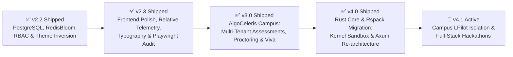
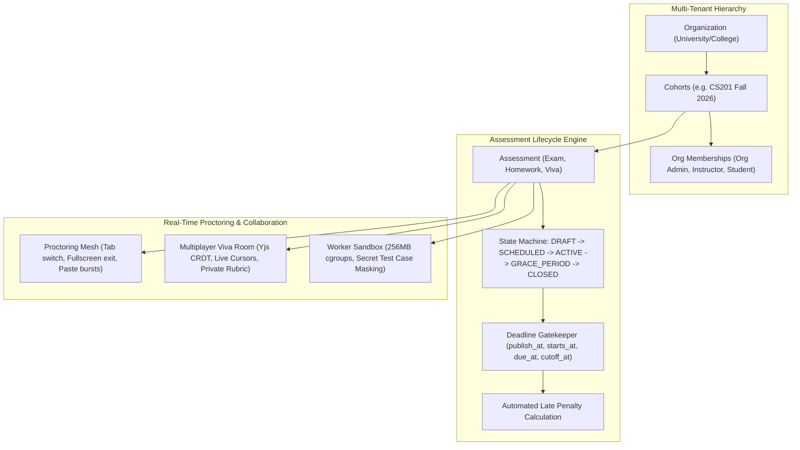
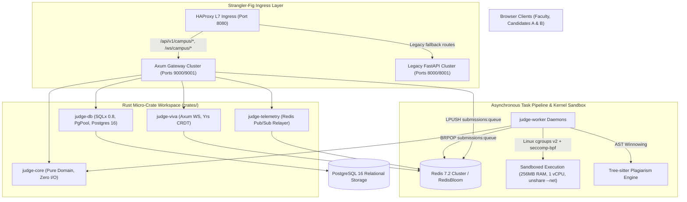

# Technical Architecture Blueprint: Cloud-Judge V2 Roadmap & Execution Plan

**Role:** Systems Architect (`@architect`)  
**Status:** PROPOSED & RATIFIED  
**Target Platform:** AlgoCeleris / Cloud-Judge V2  
**Current Milestone Focus:** **Milestone v4.1 — Isolated Multi-Tenant Campus Portal (LPilot Architecture), 3-Tier Institutional Hierarchy & Full-Stack Hackathon Platform**  
**Completed Milestones:** **Milestone v2.3 — Frontend Polish, Visual Stability & Automated UI Audit [COMPLETED]** | **Milestone v3.0 — AlgoCeleris Campus: Multi-Tenant Institutional Assessment & Live Proctoring Portal [COMPLETED]** | **Milestone v4.0 — Rust Core & Rspack Migration: High-Throughput Kernel Sandboxing & Complete Backend Re-architecture [COMPLETED]**  
**Operational Invariant:** Read-only planning artifact; zero production code modified during blueprinting.

---

## 1. Executive Roadmap & Milestone Matrix

To deliver enterprise campus capability and sub-millisecond execution throughput while maintaining zero regression on core judge performance, the execution roadmap is structured as follows:



| Milestone | Scope & Themes | Key Invariants | Target Phases |
|---|---|---|---|
| **v2.3** *(Completed)* | **Frontend Polish, Visual Stability & Automated UI Audit** | Verified relative WS origins, concentric border-radii, tabular-nums, responsive workspace tabs, and headless Playwright crawl across 7 routes and 2 viewports. | Phases 1–4 [COMPLETED] |
| **v3.0** *(Completed)* | **AlgoCeleris Campus: Multi-Tenant Institutional Assessment & Live Proctoring Portal** | Enterprise multi-tenancy (`organizations`, `cohorts`), assignment & exam lifecycle engine, deadline gatekeepers, late penalty calculator, secret test suites, real-time proctoring telemetry mesh, and live Yjs CRDT multiplayer viva rooms. | Phases 5–15 [COMPLETED] |
| **v4.0** *(Completed)* | **Rust Core & Rspack Migration: High-Throughput Kernel Sandboxing & Complete Backend Re-architecture** | Rsbuild/Rspack cutover, modular Rust workspace (`crates/`), cgroups v2 + seccomp-bpf sandboxing, Tree-sitter AST winnowing, Axum 0.8 + Tower + Tokio, `yrs` CRDT viva sync, and HAProxy Strangler-Fig cutover. | 18 Phases across Tracks A–G [COMPLETED] |
| **v4.1** *(Active)* | **Isolated Multi-Tenant Campus Portal (LPilot Architecture), 3-Tier Institutional Hierarchy & Full-Stack Hackathon Platform** | Navbar decoupling (`Hackathons` in, `Campus` out), `/auth/login` institutional gateway card, `/campus` LPilot landing & 3-step onboarding wizard, co-branded split-screen login, strict 3-tier sidebar (`student`/`faculty`/`org_admin`), 6-stage progressive lab room with section-locked code, 4-tab student analytics, and full-stack Hackathons catalog + Command Center with Axum routes. | Phases 19–24 |

---

# PART I: MILESTONE v2.3 ARCHITECTURAL BLUEPRINT
## "Frontend Polish, Visual Stability & Automated UI Audit"

### Design Read & Anti-Slop Dial Calibration (`design-taste-frontend`)
- **Design Read:** High-performance developer platform and online judge for competitive programmers and interview candidates, utilizing the Refero Linear Midnight precision palette, strict hairline geometry, dark mode inversion, and high data density.
- **Dial Calibration:**
  - `DESIGN_VARIANCE: 6` (Structured, intentional, disciplined developer tool; no random artsy chaos).
  - `MOTION_INTENSITY: 4` (Snappy, utilitarian, 150ms transitions; zero lingering floats or bounce slop).
  - `VISUAL_DENSITY: 5` (Compact, high-information cockpit; optimized for multi-pane coding workspaces).

---

## Phase 1: Telemetry & Relative Endpoint Fixes

### 1.1 Problem Audit & Root Cause Analysis
1. **Mobile & Tunnel "Offline" Badge Bug (`LinearHeaderNav.tsx:L19`):**
   - **Defect:** The top navigation latency ping issues a hardcoded request to `http://localhost:8080/health`.
   - **Impact:** When accessing the platform via mobile devices, local area networks (e.g., `192.168.1.x:3000`), or Cloudflare Tunnels (e.g., `https://*.trycloudflare.com`), the client device attempts to ping `localhost:8080` *on the mobile device itself*, which fails and permanently displays the red `"offline"` badge despite the platform being completely healthy.
2. **WebSocket Host Resolution Failure (`api.ts:L198-202`):**
   - **Defect:** `getWsHost()` inspects `window.location.port === '3000'` and conditionally returns `localhost:8080` or fallback `localhost:8000`.
   - **Impact:** On external tunnels, `window.location.port` is empty (`""` for 80/443). Furthermore, hardcoding `localhost:8080` in local development bypasses Vite's built-in `/ws` reverse proxy (`vite.config.ts:L14-19`), which breaks tunnel forwarding and causes mixed-content / CORS rejections on HTTPS tunnels.
3. **API Base URL Fragmentation (`api.ts:L13-18`):**
   - **Defect:** `getApiBaseUrl()` alternates between `http://localhost:8000` and `http://localhost:8080` based on port checks.
   - **Architectural Violation:** Violates `.agents/rules/domain-specific-validation.md` ("Do not hardcode absolute URLs `localhost:8080`; use relative endpoints or dynamic origins").

### 1.2 Architectural Specification
- **Unified Relative Gateway Client:**
  - Replace all hardcoded origin resolvers with a dynamic origin builder:
    ```typescript
    // In production, external tunnels, and Vite dev server, relative URLs route correctly:
    export const getApiBaseUrl = (): string => '';
    ```
  - `LinearHeaderNav.tsx` must ping `/api/v1/health` (relative path) instead of `http://localhost:8080/health`:
    ```typescript
    const res = await fetch('/api/v1/health', { cache: 'no-store' });
    ```
- **Universal Relative WebSocket Builder:**
  - Build WebSocket URLs dynamically from the browser's current location:
    ```typescript
    export const buildWebSocketUrl = (path: string): string => {
      const isHttps = typeof window !== 'undefined' && window.location.protocol === 'https:';
      const wsProtocol = isHttps ? 'wss:' : 'ws:';
      const host = typeof window !== 'undefined' ? window.location.host : 'localhost:3000';
      const cleanPath = path.startsWith('/') ? path : `/${path}`;
      return `${wsProtocol}//${host}${cleanPath}`;
    };
    ```
  - In local development (`localhost:3000`), Vite proxies `/ws` directly to HAProxy (`ws://localhost:8080`).
  - Through Cloudflare Tunnel (`https://xxx.trycloudflare.com`), requests upgrade transparently over `wss://` to the tunnel origin.

### 1.3 Acceptance Criteria & Verification
- `curl -s -I -H "Host: tunnel.trycloudflare.com" http://localhost:3000/api/v1/health` returns `200 OK`.
- Accessing the app through an external hostname or mobile viewport renders the green `"online"` latency badge with true millisecond round-trip telemetry.
- Submission streaming connects over WebSocket without host mismatch errors.

---

## Phase 2: Web Design Guidelines & Typography Audit

### 2.1 Concentric Border-Radii Audit & Mathematical Enforcement
In nested card and container layouts, mismatched border radii create visual friction and "pinched" corners.
- **The Concentric Radius Invariant:**
  $$\text{Radius}_{\text{inner}} = \max\left(0, \text{Radius}_{\text{outer}} - \text{Padding}\right)$$
- **Audit Target Selectors in `index.css`:**
  1. `.linear-nav`: Outer radius `0px` (flush), inner elements `.linear-brand` (`var(--radius-sm)`: 4px), `.latency-pill` (`var(--radius-full)`: 9999px).
  2. `.nav-user-cluster` / `.nav-guest-cluster`:
     - Parent container padding: `3px`. Outer radius: `var(--radius-md)` (6px).
     - Inner avatar / pills: Inner radius must be `6px - 3px = 3px` (or `var(--radius-sm)`).
  3. `.linear-card` & `.auth-card`:
     - Parent outer radius: `var(--radius-lg)` (10px). Parent padding: `24px` / `16px`.
     - Inner input fields (`.linear-input`): Inner radius must be `var(--radius-md)` (6px).
  4. `.problem-table-container`:
     - Table wrapper: `border-radius: var(--radius-lg)` (10px).
     - Inner table header and row hover states must respect corner clipping (`overflow: hidden`).
  5. Modal Dialogs (`.modal-card`, `.ai-debug-modal`):
     - Dialog container: `border-radius: var(--radius-lg)` (10px), padding: `20px`.
     - Internal diff viewer / code block: `border-radius: var(--radius-md)` (6px).

### 2.2 Tabular Figures & Numerical Stability (`font-variant-numeric: tabular-nums`)
Dynamic counter numbers jumping in width as digits change creates visual jitter and layout instability.
- **Enforce `font-variant-numeric: tabular-nums` across:**
  - `.latency-pill`: Latency millisecond counter (`${latency}ms`).
  - `.contest-countdown`: Active/upcoming countdown timers (`HH:MM:SS`).
  - `.problem-row-id`: Problem catalog index numbers (`#1`, `#12`).
  - `.stat-value`, `.metric-value`: User profile statistics and rating cards.
  - `.editor-line-numbers`: Monaco Editor line numbers and test diff viewers.
  - `.stopwatch-timer`: Watchdog countdowns and execution timers.

### 2.3 Optical Alignment, Icon-Text Pairings & Contrast Audit
- **Optical Baseline Alignment:**
  - All icon + label clusters (`.linear-brand`, `.latency-pill`, `.nav-link`, `.tag-pill`, `.btn-primary`) must enforce:
    ```css
    display: inline-flex;
    align-items: center;
    gap: 6px; /* Explicit gap, zero arbitrary margin-right hacks */
    line-height: 1;
    ```
- **Uppercase Tracking Invariant:**
  - Any badge or caption rendered with `text-transform: uppercase` must declare `letter-spacing: 0.04em` to prevent compressed letterforms.
- **Contrast & Token Compliance (WCAG 2.1 AA):**
  - **Dark Mode (Linear Midnight):**
    - Body text: `--text-primary` (`#f7f8f8`) on `--bg-canvas` (`#08090a`) = 18.2:1 (AAA).
    - Secondary text: `--text-secondary` (`#8a8f98`) on `--bg-surface` (`#0f1011`) = 6.4:1 (AA).
    - Hairline dividers: `--border-subtle` (`#23252a`) on `--bg-surface` (`#0f1011`).
  - **Light Mode (Linear Light):**
    - Body text: `--text-primary` (`#111827`) on `--bg-canvas` (`#f7f8f9`) = 16.5:1 (AAA).
    - Muted text: Audit `--text-muted` (`#8b929e`) to ensure minimum 4.5:1 contrast against `#ffffff`.

---

## Phase 3: Anti-Slop Visual Polish & Mobile Layout Hardening [COMPLETED]

### 3.1 Responsive Breakpoints & Viewport Architecture
```css
/* Core Breakpoint System */
--breakpoint-mobile: 768px;
--breakpoint-tablet: 1024px;
--breakpoint-desktop: 1280px;
```

### 3.2 Workspace Mobile Hardening (`ProblemWorkspacePage.tsx` & `ResizableLayout.tsx`)
- **Current Defect:**
  - `ResizableLayout` enforces fixed horizontal split percentages (`leftWidthPercent: 42%`). On mobile viewports (< 768px), this compresses the problem description and code editor into unusable slivers.
- **Architectural Solution:**
  - **Desktop (>= 1024px):** Maintain 3-pane resizable layout with drag handles.
  - **Mobile & Tablet (< 1024px):** Automatically convert the workspace into a high-ergonomics **Tabbed View**:
    - Tabs: `[ 📄 Problem | 💻 Code Editor | 🧪 Test Cases & Output ]`.
    - Active tab takes 100% width and 100% available viewport height.
    - Floating action bar at bottom: Language selector + Acid Lime "Run" and "Submit" buttons always reachable.

### 3.3 Navigation Mobile Hardening (`LinearHeaderNav.tsx`)
- **Mobile Navigation Drawer / Sheet:**
  - On screens < 768px, collapse navigation items (`Problems`, `Contests`, `Latency`, `User Profile`) behind a sleek Obsidian slide-over menu or compact icon bar.
  - Ensure theme toggle and profile links remain accessible without horizontal overflow.

### 3.4 Monaco Editor Touch & Virtual Keyboard Ergonomics
- Add mobile viewport meta and Monaco options for mobile browsers:
  - Disable minimap unconditionally on touch viewports.
  - Increase line number gutter touch target.
  - Bind `automaticLayout: true` with debounced resize observers.
  - Set `overflow: hidden` on parent containers to eliminate iOS Safari bounce-scroll clipping.

### 3.5 Seamless Theme Inversion Transitions
- Add global transition token to eliminate layout flash:
  ```css
  body, .linear-nav, .linear-card, .workspace-pane, .problem-pane {
    transition: background-color 0.15s ease, border-color 0.15s ease, color 0.15s ease;
  }
  ```
- Guarantee that Monaco Editor theme synchronizes via `monaco.editor.setTheme()` without unmounting the component or clearing the undo/redo stack.

---

## Phase 4: Autonomous Playwright & DevTools Verification [COMPLETED]

### 4.1 Verification Strategy
An autonomous, zero-regression verification suite testing the entire platform in headless Chromium across both desktop and mobile viewports.

### 4.2 Route Coverage Matrix
| Route | Viewports Tested | Assertions |
|---|---|---|
| `/` (Landing Page) | Desktop (1440x900), Mobile (390x844) | Hero rendered, benchmark telemetry active, runner teaser functional, 0 console errors. |
| `/problems` (Catalog) | Desktop, Mobile | 12 problems rendered, search input reactive, difficulty tags aligned, no overflow. |
| `/problems/two-sum` (Workspace) | Desktop, Mobile | Desktop: 3 panes visible. Mobile: Tab switcher active, editor rendered, Acid Lime button visible. |
| `/contests` (Contests Hub) | Desktop, Mobile | Countdown timer has `tabular-nums`, registration toggle reactive, leaderboards loaded. |
| `/u/admin` (Profile) | Desktop, Mobile | Rating progress chart, solved ring SVG, 3D skyline canvas visible without clipping. |
| `/auth/login` (Auth Card) | Desktop, Mobile | Centered Carbon card, form inputs valid, concentric radii enforced. |

### 4.3 Automated Verification Harness
- Create script `scripts/verify-ui-audit.mjs` using `@playwright/test` / `playwright`:
  - Starts browser in headless mode.
  - Emulates desktop (`1440x900`) and mobile (`390x844`, iPhone user agent).
  - Listens to `page.on('console', msg => { if (msg.type() === 'error') throw ... })`.
  - Listens to `page.on('pageerror', err => throw err)`.
  - Captures reference screenshots to `.planning/ui-audit-snapshots/`.
  - Asserts zero unhandled exceptions, zero network 404s, and zero layout overflow (`scrollWidth <= clientWidth`).

---

# PART II: MILESTONE v3.0 ARCHITECTURAL BLUEPRINT
## "AlgoCeleris Campus: Multi-Tenant Institutional Assessment & Live Proctoring Portal"

### 1. Executive Architectural Scope & Domain Model

Milestone v3.0 transforms AlgoCeleris / Cloud-Judge V2 into an institutional assessment and proctoring engine tailored for universities, colleges, and engineering academies. It introduces multi-tenant hierarchy, flexible assignment/exam lifecycle orchestration, deadline gatekeepers with automated late penalty calculation, secret test suite evaluation, live proctoring telemetry streaming, and 1-on-1 collaborative Viva interview rooms with private faculty grading rubrics.



---

### 2. Multi-Tenant Relational Schema (PostgreSQL 16 & Alembic `0002_campus_portal.py`)

All primary keys use UUIDs generated via `uuid.uuid4()`. Schema mutations are versioned via Alembic migrations.

```sql
-- 1. Organizations
CREATE TABLE organizations (
    id UUID PRIMARY KEY DEFAULT gen_random_uuid(),
    name VARCHAR(255) NOT NULL,
    slug VARCHAR(100) UNIQUE NOT NULL,
    domain_whitelist JSONB DEFAULT '[]'::jsonb NOT NULL,
    branding_config JSONB DEFAULT '{}'::jsonb NOT NULL,
    created_at TIMESTAMPTZ DEFAULT NOW() NOT NULL,
    updated_at TIMESTAMPTZ DEFAULT NOW() NOT NULL
);
CREATE INDEX idx_org_slug ON organizations(slug);

-- 2. Cohorts (Batches / Classes)
CREATE TABLE cohorts (
    id UUID PRIMARY KEY DEFAULT gen_random_uuid(),
    org_id UUID NOT NULL REFERENCES organizations(id) ON DELETE CASCADE,
    name VARCHAR(255) NOT NULL,
    code VARCHAR(50) NOT NULL, -- e.g. "CS201-F26"
    term VARCHAR(50) NOT NULL, -- e.g. "Fall 2026"
    is_active BOOLEAN DEFAULT TRUE NOT NULL,
    created_at TIMESTAMPTZ DEFAULT NOW() NOT NULL,
    CONSTRAINT uq_org_cohort_code UNIQUE (org_id, code)
);
CREATE INDEX idx_cohorts_org ON cohorts(org_id);

-- 3. Organization Memberships & Institutional Roles
CREATE TYPE campus_role AS ENUM ('org_admin', 'instructor', 'teaching_assistant', 'student');
CREATE TYPE membership_status AS ENUM ('active', 'invited', 'suspended');

CREATE TABLE org_memberships (
    id UUID PRIMARY KEY DEFAULT gen_random_uuid(),
    org_id UUID NOT NULL REFERENCES organizations(id) ON DELETE CASCADE,
    user_id UUID NOT NULL REFERENCES users(id) ON DELETE CASCADE,
    cohort_id UUID REFERENCES cohorts(id) ON DELETE SET NULL,
    role campus_role DEFAULT 'student' NOT NULL,
    status membership_status DEFAULT 'active' NOT NULL,
    created_at TIMESTAMPTZ DEFAULT NOW() NOT NULL,
    CONSTRAINT uq_user_org_cohort UNIQUE (org_id, user_id, cohort_id)
);
CREATE INDEX idx_org_memberships_user ON org_memberships(user_id);
CREATE INDEX idx_org_memberships_cohort ON org_memberships(cohort_id);

-- 4. Assessments (Exams, Assignments, Viva Sessions)
CREATE TYPE assessment_mode AS ENUM ('EXAM', 'HOMEWORK', 'VIVA');
CREATE TYPE assessment_status AS ENUM ('DRAFT', 'SCHEDULED', 'ACTIVE', 'GRACE_PERIOD', 'CLOSED');

CREATE TABLE assessments (
    id UUID PRIMARY KEY DEFAULT gen_random_uuid(),
    org_id UUID NOT NULL REFERENCES organizations(id) ON DELETE CASCADE,
    cohort_id UUID NOT NULL REFERENCES cohorts(id) ON DELETE CASCADE,
    title VARCHAR(255) NOT NULL,
    description TEXT NOT NULL,
    mode assessment_mode DEFAULT 'EXAM' NOT NULL,
    status assessment_status DEFAULT 'DRAFT' NOT NULL,
    problem_slugs JSONB DEFAULT '[]'::jsonb NOT NULL,
    scoring_rubric JSONB DEFAULT '{}'::jsonb NOT NULL,
    publish_at TIMESTAMPTZ NOT NULL,
    starts_at TIMESTAMPTZ NOT NULL,
    due_at TIMESTAMPTZ NOT NULL,
    cutoff_at TIMESTAMPTZ NOT NULL,
    duration_minutes INT, -- Nullable for homework; strict countdown window for exams
    late_penalty_percent_per_hour DOUBLE PRECISION DEFAULT 0.0 NOT NULL,
    max_late_penalty_percent DOUBLE PRECISION DEFAULT 100.0 NOT NULL,
    proctoring_config JSONB DEFAULT '{"fullscreen_required": true, "track_tab_switches": true, "block_clipboard": false}'::jsonb NOT NULL,
    created_by UUID NOT NULL REFERENCES users(id) ON DELETE RESTRICT,
    created_at TIMESTAMPTZ DEFAULT NOW() NOT NULL,
    updated_at TIMESTAMPTZ DEFAULT NOW() NOT NULL,
    CONSTRAINT ck_assessment_timeline CHECK (
        publish_at <= starts_at AND
        starts_at <= due_at AND
        due_at <= cutoff_at
    )
);
CREATE INDEX idx_assessments_cohort ON assessments(cohort_id);
CREATE INDEX idx_assessments_status ON assessments(status);

-- 5. Assessment Submissions & Final Grades
CREATE TABLE assessment_submissions (
    id UUID PRIMARY KEY DEFAULT gen_random_uuid(),
    assessment_id UUID NOT NULL REFERENCES assessments(id) ON DELETE CASCADE,
    user_id UUID NOT NULL REFERENCES users(id) ON DELETE CASCADE,
    submission_id UUID NOT NULL REFERENCES submissions(id) ON DELETE CASCADE,
    raw_score DOUBLE PRECISION DEFAULT 0.0 NOT NULL,
    late_penalty_deduction DOUBLE PRECISION DEFAULT 0.0 NOT NULL,
    final_score DOUBLE PRECISION DEFAULT 0.0 NOT NULL,
    submitted_at TIMESTAMPTZ DEFAULT NOW() NOT NULL,
    is_late BOOLEAN DEFAULT FALSE NOT NULL,
    proctor_events_count INT DEFAULT 0 NOT NULL,
    eval_verdict VARCHAR(50) DEFAULT 'PENDING' NOT NULL,
    feedback_notes TEXT
);
CREATE INDEX idx_asub_assessment_user ON assessment_submissions(assessment_id, user_id);

-- 6. Interview & Viva Rooms (Multiplayer CRDT)
CREATE TABLE interview_rooms (
    id UUID PRIMARY KEY DEFAULT gen_random_uuid(),
    org_id UUID REFERENCES organizations(id) ON DELETE CASCADE,
    assessment_id UUID REFERENCES assessments(id) ON DELETE SET NULL,
    room_code VARCHAR(32) UNIQUE NOT NULL,
    host_user_id UUID NOT NULL REFERENCES users(id) ON DELETE CASCADE,
    candidate_user_id UUID NOT NULL REFERENCES users(id) ON DELETE CASCADE,
    problem_slug VARCHAR(100) NOT NULL,
    language VARCHAR(20) DEFAULT 'python' NOT NULL,
    status VARCHAR(30) DEFAULT 'WAITING' NOT NULL,
    editor_code TEXT DEFAULT '' NOT NULL,
    interviewer_notes TEXT DEFAULT '' NOT NULL,
    rubric_scores JSONB DEFAULT '{}'::jsonb NOT NULL,
    created_at TIMESTAMPTZ DEFAULT NOW() NOT NULL,
    updated_at TIMESTAMPTZ DEFAULT NOW() NOT NULL
);
CREATE INDEX idx_interview_rooms_code ON interview_rooms(room_code);

-- 7. Proctoring Telemetry Events
CREATE TABLE proctor_events (
    id UUID PRIMARY KEY DEFAULT gen_random_uuid(),
    assessment_id UUID NOT NULL REFERENCES assessments(id) ON DELETE CASCADE,
    user_id UUID NOT NULL REFERENCES users(id) ON DELETE CASCADE,
    event_type VARCHAR(50) NOT NULL, -- tab_switch, fullscreen_exit, paste_burst, disconnect
    severity VARCHAR(20) DEFAULT 'warning' NOT NULL,
    metadata JSONB DEFAULT '{}'::jsonb NOT NULL,
    created_at TIMESTAMPTZ DEFAULT NOW() NOT NULL
);
CREATE INDEX idx_proctor_assessment ON proctor_events(assessment_id, user_id);
```

---

### 3. Gateway Multi-Tenant RBAC Architecture

Enforced via FastAPI dependency injection returning structured 403 payloads on authorization failures.

```python
# Authorization Guards
async def require_org_admin(org_id: uuid.UUID, user: User = Depends(get_current_user), db: AsyncSession = Depends(get_db)) -> OrgMembership:
    """Verifies user has 'org_admin' role within the target organization."""
    ...

async def require_instructor(org_id: uuid.UUID, user: User = Depends(get_current_user), db: AsyncSession = Depends(get_db)) -> OrgMembership:
    """Verifies user has 'instructor' or 'org_admin' privileges."""
    ...

async def require_student(assessment_id: uuid.UUID, user: User = Depends(get_current_user), db: AsyncSession = Depends(get_db)) -> Assessment:
    """Verifies student is actively enrolled in the assessment's cohort and timing window is open."""
    ...
```

**Standardized 403 Forbidden Payload:**
```json
{
  "error": "insufficient_campus_permissions",
  "message": "Instructor privileges required for CS201 cohort assessments",
  "org_id": "3fa85f64-5717-4562-b3fc-2c963f66afa6",
  "required_role": "instructor",
  "user_role": "student"
}
```

---

### 4. Assessment Engine State Machine & Deadline Gatekeepers

#### 4.1 State Machine Lifecycle
$$\text{DRAFT} \xrightarrow{\text{publish}} \text{SCHEDULED} \xrightarrow{\text{starts\_at}} \text{ACTIVE} \xrightarrow{\text{due\_at}} \text{GRACE\_PERIOD} \xrightarrow{\text{cutoff\_at}} \text{CLOSED}$$

- **`DRAFT`**: Faculty authoring problem list, weights, and rubric. Invisible to students.
- **`SCHEDULED`**: Calendar entry visible; student arena entrance locked.
- **`ACTIVE`**: Exam session timer ticks; code execution permitted; proctoring telemetry streaming active.
- **`GRACE_PERIOD`**: Submissions accepted with automated late penalty calculation.
- **`CLOSED`**: Submissions strictly rejected (`403 assessment_cutoff_passed`). In-progress buffers automatically submitted.

#### 4.2 Automated Late Penalty Formulation
$$\Delta t_{\text{hours}} = \max\left(0, \left\lceil \frac{t_{\text{submission}} - t_{\text{due}}}{3600} \right\rceil\right)$$
$$\text{PenaltyPercent} = \min\left(\text{MaxPenalty}, \Delta t_{\text{hours}} \times \text{LatePenaltyPerHour}\right)$$
$$\text{FinalScore} = \max\left(0.0, \text{RawScore} \times \left(1.0 - \frac{\text{PenaltyPercent}}{100.0}\right)\right)$$

#### 4.3 Secret Test Cases & Masking Policy
- **Sample/Public Tests**: Evaluated live during exam runs; full inputs, outputs, and diffs returned in execution stream.
- **Secret Institutional Tests**: Evaluated inside the worker sandbox (256MB RAM, 1 CPU limit, zero network). During the `ACTIVE` and `GRACE_PERIOD` windows, only binary pass/fail counts are persisted; raw inputs and expected outputs are cryptographically masked until the instructor explicitly triggers **"Release Final Grades"**.

---

### 5. Real-Time Telemetry & Viva Protocol Specification

#### 5.1 Proctoring Telemetry WebSocket (`/ws/campus/assessments/{id}/proctor`)
- **Transport**: JSON over WebSocket upgraded by HAProxy.
- **Redis Pub/Sub Topic**: `campus:proctor:{assessment_id}:telemetry`
- **Telemetry Event Types**:
  - `heartbeat`: Client timestamp and browser focus state every 5s.
  - `tab_switch`: Emitted on `document.visibilityState === 'hidden'`.
  - `fullscreen_exit`: Emitted on `document.fullscreenElement === null`.
  - `paste_burst`: Emitted when input rate exceeds 50 chars/100ms.
  - `disconnect`: Gateway detects socket termination.
- **Proctoring Anomaly Risk Score**:
  $$\text{RiskScore} = (\text{TabSwitches} \times 5) + (\text{FullscreenExits} \times 10) + (\text{PasteBursts} \times 15)$$

#### 5.2 Collaborative Viva & Interview WebSocket (`/ws/campus/viva/{room_code}`)
- **Transport**: Yjs CRDT binary updates (`sync-step-1`, `sync-step-2`, `update`) + JSON presence envelopes.
- **Redis Pub/Sub Topic**: `campus:viva:{room_code}:events`
- **Sub-30ms Presence Envelope**:
  ```json
  {
    "type": "awareness",
    "room_code": "VIVA-CS201-9871",
    "client_id": "client-1029",
    "user_id": "usr-8192",
    "display_name": "Dr. Sarah Chen",
    "role": "instructor",
    "cursor": { "line": 42, "column": 18 },
    "selection": { "startLine": 42, "endLine": 45 },
    "color": "#e4f222"
  }
  ```
- **Execution Sharing**: Run/Submit triggers emit `{ type: "execution_trigger", author_id: "..." }`. Worker daemons stream evaluation events concurrently to both instructor and student viewports.
- **Private Rubric Drawer**: Rubric scoring mutations (`PATCH /api/v1/campus/viva/{room_code}/rubric`) update `interview_rooms.rubric_scores` and are hidden from student payloads.

---

### 6. The 11 Implementation Phases (Atomic Execution Plan)

#### Phase 5: Multi-Tenant Campus Relational Schema & Alembic Migrations [COMPLETED]
- **Scope**: Generate and apply Alembic migration `0002_campus_portal.py`. Define SQLAlchemy 2.0 Async declarative models for `organizations`, `cohorts`, `org_memberships`, `assessments`, `assessment_submissions`, `interview_rooms`, and `proctor_events`.
- **Breaking Changes**: Extends existing `submissions` table with nullable `assessment_id` and `room_id`. Fully backwards-compatible with standard competitive programming submissions.
- **Acceptance Criteria**:
  ```bash
  alembic upgrade head
  python -c "from packages.gateway.src.models.entities import Organization, Cohort, Assessment; print('Entities verified')"
  ```

#### Phase 6: Gateway Multi-Tenant RBAC & Organization/Cohort REST APIs [COMPLETED]
- **Scope**: Implement dependencies `require_org_admin`, `require_instructor`, `require_student`. Build REST endpoints:
  - `POST /api/v1/campus/orgs` & `GET /api/v1/campus/orgs/{org_id}`
  - `POST /api/v1/campus/orgs/{org_id}/members/batch` (CSV/JSON roster import)
  - `POST /api/v1/campus/orgs/{org_id}/cohorts` & `GET /api/v1/campus/cohorts/{cohort_id}/roster`
- **Acceptance Criteria**:
  ```bash
  pytest packages/gateway/tests/test_campus_rbac.py -v
  ```

#### Phase 7: Assessment Engine State Machine, Deadline Gatekeeper & Late Penalty Calculator [COMPLETED]
- **Scope**: Build assessment state engine and submission validators. Implement formula-driven late penalty deduction. Implement deadline gatekeepers preventing submissions after `cutoff_at`.
- **Acceptance Criteria**:
  ```bash
  pytest packages/gateway/tests/test_assessment_lifecycle.py -v
  ```

#### Phase 8: Secret Test Suite Worker Sandbox Isolation & Evaluation Pipeline [COMPLETED]
- **Scope**: Enhance worker daemon to evaluate both public and secret institutional test suites. Enforce output masking during `ACTIVE` and `GRACE_PERIOD` windows. Implement faculty grade release trigger.
- **Acceptance Criteria**:
  ```bash
  pytest packages/gateway/tests/test_secret_test_masking.py -v
  ```

#### Phase 9: Real-Time Proctoring Telemetry Mesh & Redis Pub/Sub Event Relayer [COMPLETED]
- **Scope**: Build `/ws/campus/assessments/{id}/proctor` gateway handler. Implement Redis Pub/Sub stream relayer across dual-gateways. Implement real-time risk score aggregation.
- **Acceptance Criteria**:
  ```bash
  pytest packages/gateway/tests/test_proctoring_mesh.py -v
  ```

#### Phase 10: Multiplayer Viva & Collaborative Interview Engine (Yjs CRDT & Live Cursors) [COMPLETED]
- **Scope**: Implement `/ws/campus/viva/{room_code}` supporting Yjs CRDT binary updates and JSON awareness broadcasts. Wire dual-gateway distribution via Redis Pub/Sub. Implement private rubric update API.
- **Acceptance Criteria**:
  ```bash
  pytest packages/gateway/tests/test_viva_crdt_sync.py -v
  ```

#### Phase 11: Faculty Assessment Scheduler, Interactive Calendar & Rubric Builder UI: [COMPLETED]
- **Scope**: Create `/campus/assessments/new` (interactive timeline picker, penalty slider, problem selection, rubric builder) and `/campus/calendar` (monthly/weekly assessment schedule color-coded by cohort).
- **Design Tokens**: Refero Linear Midnight, tabular numbers for dates, hairline borders.
- **Acceptance Criteria**:
  ```bash
  node scripts/test-phase11-faculty-scheduler.mjs
  npm --prefix packages/frontend run build
  ```

#### Phase 12: Student Exam Arena, Fullscreen Proctoring Lock & Auto-Submit Watchdog UI: [COMPLETED]
- **Scope**: Create `/campus/assessments/:id/arena`. Integrate browser Fullscreen API with exit warnings, countdown watchdog timer, and automated client-side serialization and submit on timer expiry or cutoff.
- **Acceptance Criteria**:
  ```bash
  node scripts/test-phase12-exam-arena.mjs
  npm --prefix packages/frontend run build
  ```

#### Phase 13: Faculty Live Proctoring Cockpit & Real-Time Integrity Dashboard UI: [COMPLETED]
- **Scope**: Create `/campus/assessments/:id/cockpit` and `/portal/:org_slug/assessments/:id/cockpit`. Real-time student grid showing active state, violation counters (tab switches, fullscreen drops, paste bursts), dynamic risk badges (Acid Lime < 15, Amber 15-34, Crimson >= 35 with pulsing alert dot), live UTC clock with tabular numerals, WebSocket telemetry relayer hook, collapsible incident feed, viva escalation trigger, time accommodations (+15m, +30m), and force-submit confirmation modal.
- **Acceptance Criteria**:
  ```bash
  node scripts/test-phase13-proctor-cockpit.mjs
  npm --prefix packages/frontend run build
  python3 -m pytest packages/gateway/tests/test_campus_*.py packages/gateway/tests/test_proctoring_*.py
  ```

#### Phase 14: 3-Pane Viva Interview Workspace & Private Instructor Rubric Drawer UI: [COMPLETED]
- **Scope**: Create `/campus/viva/:room_code` and `/portal/:org_slug/viva/:room_code`. 3-pane resizable layout featuring:
  1. Left Pane: Candidate problem switcher, difficulty badge, tags, description, sample test cases, and interview guidelines.
  2. Center Pane: Monaco Editor connected to `/ws/campus/viva/{room_code}` with simulated/live CRDT buffer updates, peer remote carets, selection highlights, and bottom execution terminal drawer.
  3. Right Pane / Drawer: Private Faculty Evaluation Rubric Drawer (visible exclusively to `instructor` / `org_admin` / `host`), with criterion sliders, weight multipliers, composite weighted score calculation, confidential notes, and instant save to `PATCH /api/v1/campus/viva/{room_code}/rubric`.
  4. Candidate Masking Invariant: Student/candidate views completely omit the private rubric drawer from the DOM.
- **Acceptance Criteria**:
  ```bash
  node scripts/test-phase14-viva-workspace.mjs
  npm --prefix packages/frontend run build
  python3 -m pytest packages/gateway/tests/test_viva_*.py packages/gateway/tests/test_campus_*.py
  ```

#### Phase 15: Multi-Role End-to-End Playwright Verification Suite & Chaos Load Test [COMPLETED]
- **Scope**: Build `scripts/verify-campus-portal.mjs` executing end-to-end multi-role simulation:
  1. Org Admin sets up campus & cohort.
  2. Instructor creates timed exam with secret test cases & late penalty.
  3. Student 1 completes exam within deadline; student 2 submits during grace period verifying late penalty deduction math.
  4. Proctoring Cockpit asserts real-time violation event delivery.
  5. Dual-client Viva room asserts bidirectional CRDT synchronization under concurrent keystrokes and private rubric score persistence.
- **Acceptance Criteria**:
  ```bash
  node scripts/verify-campus-portal.mjs
  ```

---

### 7. Acceptance Criteria for Milestone v3.0 Execution

1. **Phase 5 (Relational Schema): [COMPLETED]**
   - Migration `0002_campus_portal.py` executes cleanly on PostgreSQL 16.
   - All 7 new entities importable and mapped via SQLAlchemy 2.0 Async / asyncpg.
2. **Phase 6 (Multi-Tenant RBAC & REST APIs): [COMPLETED]**
   - `require_org_admin`, `require_instructor`, and `require_student` return structured 403 payloads on unauthorized access.
   - Roster CSV batch import registers student memberships in bulk.
3. **Phase 7 (Assessment Engine Lifecycle): [COMPLETED]**
   - State machine enforces DRAFT -> SCHEDULED -> ACTIVE -> GRACE_PERIOD -> CLOSED progression.
   - Late penalty calculations match formula within 0.01% precision.
   - Submissions past `cutoff_at` strictly rejected.
4. **Phase 8 (Secret Test Suites): [COMPLETED]**
   - Worker sandbox evaluates secret institutional tests under 256MB RAM / 1 vCPU / zero network constraints.
   - Student submissions receive masked test case outputs until instructor triggers grade publication.
5. **Phase 9 (Proctoring Telemetry Mesh): [COMPLETED]**
   - Sub-50ms ingestion and relay of `tab_switch`, `fullscreen_exit`, and `paste_burst` events over Redis Pub/Sub.
   - Aggregated anomaly risk score updates live on instructor dashboard.
6. **Phase 10 (Multiplayer Viva Engine): [COMPLETED]**
   - Sub-30ms bidirectional code synchronization via Yjs CRDT over WebSocket.
   - Peer cursor awareness and private instructor rubric grading preserved without leaking to student view.
7. **Phase 11 (Faculty Assessment Scheduler & Interactive Calendar): [COMPLETED]**
   - `/campus/assessments/new` (timeline picker, late penalty sliders, problem bank selector, and 100% balanced rubric builder) and `/campus/calendar` (cohort-tagged active/scheduled assessment grid with tabular-nums countdowns) compile and pass production build.
8. **Phase 12 (Student Exam Arena & Watchdog UI): [COMPLETED]**
   - `/campus/assessments/:id/arena` (readiness modal, fullscreen integrity sentinel, watchdog auto-submit timer, Monaco editor with secret test masking) compiles and passes production build.
9. **Phases 13–14 (Campus UI Modules): [COMPLETED]**
   - Live Proctoring Cockpit and 3-Pane Viva Workspace compile and render with Refero Linear Midnight tokens.
10. **Phase 15 (Multi-Role Playwright Suite & Load Test): [COMPLETED]**
   - Automated end-to-end multi-role test suite passes 100% green with zero console errors and zero uncaught exceptions. Reference snapshots saved to `.planning/campus-audit-snapshots/`.

---

# PART III: MILESTONE v4.0 ARCHITECTURAL BLUEPRINT
## "Rust Core & Rspack Migration — High-Throughput Kernel Sandboxing & Complete Backend Re-architecture"

### 1. Executive Architectural Scope & High-Throughput Topology

Milestone v4.0 re-architects AlgoCeleris / Cloud-Judge V2 from its Python/FastAPI runtime into a high-throughput, memory-disciplined, compile-time verified Rust micro-crate ecosystem (`crates/`), paired with high-performance Rust-based frontend tooling via Rsbuild / Rspack.

#### Performance Objectives & Architectural Motivations
1. **Memory Residency Ceilings ($\le 64\text{MB}$ RSS per Gateway Daemon):**
   - The Python/FastAPI gateway processes currently occupy ~180MB RSS under baseline load due to the CPython runtime, interpreter overhead, and async event loop heap structures.
   - The compiled Axum 0.8 / Tokio daemons reduce baseline memory consumption to $\le 64\text{MB}$ RSS, enabling deployment on resource-constrained AWS `t2.micro`/`t3.micro` burstable instances without paging pressure.
2. **True Kernel Sandboxing & Sub-50ms Evaluation Startup:**
   - Code evaluation transitions from external subshells to direct Linux `cgroups v2` hierarchical controllers and `seccomp-bpf` syscall filters implemented natively in Rust.
   - Using `unshare(CLONE_NEWNET | CLONE_NEWPID | CLONE_NEWIPC | CLONE_NEWUTS | CLONE_NEWNS)` and explicit capability dropping (`CAP_DROP_ALL`), execution starts in $\le 15\text{ms}$ without dynamic Docker container spin-up overhead.
3. **Frontend Build & HMR Acceleration (Rsbuild / Rspack):**
   - Cut build times from ~4s to $< 800\text{ms}$ while preserving Monaco Editor language WebWorker separation and the Refero Linear Midnight precision palette.
4. **Zero GC Latency Spikes in Real-Time WebSockets:**
   - Multiplayer Viva CRDT synchronization (`yrs`) and proctoring telemetry meshes (`judge-telemetry`) operate with zero garbage collection pauses and sub-5ms p99 WebSocket round-trip times.



---

### 2. Crate Boundaries & Cargo Workspace Architecture

All Rust code is organized into a modular Cargo workspace located at the root directory under `crates/`. Each crate enforces strict single-responsibility boundaries:

```
crates/
├── judge-core/       # Pure domain models, error hierarchies, pure business invariants (Zero I/O)
├── judge-db/         # SQLx 0.8 PostgreSQL 16 persistence, repositories, batch transactions
├── judge-worker/     # Kernel cgroups v2 controller, seccomp-bpf, runners, Tree-sitter winnowing
├── judge-telemetry/  # Proctoring telemetry ingestion, Redis Pub/Sub multiplexer, rate limiting
├── judge-viva/       # Real-time collaborative interview engine, Axum WebSockets, Yrs CRDT sync
└── judge-gateway/    # Axum 0.8 HTTP/REST server, Tower middleware, RBAC extractors, routes
```

#### Detailed Crate Responsibilities & Invariants

| Crate | Responsibilities & Invariants | Key Dependencies | Target Artifact |
|---|---|---|---|
| `crates/judge-core` | Pure domain entities (`Submission`, `Assessment`, `Verdict`), mathematical formulas (late penalty deduction, risk scoring), state machine transitions (`Draft -> Scheduled -> Active -> GracePeriod -> Closed`), pure domain errors. **Invariant:** Absolute zero I/O, no network or database dependencies. | `serde`, `thiserror`, `uuid`, `chrono` | `lib` |
| `crates/judge-db` | Asynchronous PostgreSQL 16 connection pooling via `sqlx::PgPool`, compile-time query verification (`sqlx::query!`), entity-to-table mappers, transactional batch CSV roster insertion (`COPY` / bulk unnest), audit log repository. | `sqlx`, `judge-core`, `tokio`, `uuid` | `lib` |
| `crates/judge-worker` | Linux `cgroups v2` hierarchical resource controllers (`memory.max=256M`, `cpu.max=100000 100000`), Linux namespace isolation (`unshare`), capability dropping, `seccomp-bpf` syscall filters, multi-language runners (GCC/C++20, Python 3.12, Java 21 OpenJDK), Tree-sitter AST winnowing plagiarism engine. | `judge-core`, `tokio`, `tree-sitter`, `tree-sitter-cpp`, `tree-sitter-python`, `tree-sitter-java`, `redis` | `bin` & `lib` |
| `crates/judge-telemetry` | High-throughput Axum WebSocket handler `/ws/campus/assessments/{id}/proctor`, Redis Pub/Sub frame relaying, sub-10ms event ingestion for `tab_switch`, `fullscreen_exit`, `paste_burst`, Token-Bucket rate limiting via Redis Lua scripts. | `judge-core`, `tokio`, `axum`, `redis`, `tower` | `lib` |
| `crates/judge-viva` | Axum WebSocket handler `/ws/campus/viva/{room_code}`, multiplayer buffer synchronization via `yrs` (Yjs CRDT), peer awareness/cursor distribution, Redis Pub/Sub cross-gateway fanout, strict instructor rubric isolation (students never receive rubric frames). | `judge-core`, `judge-db`, `yrs`, `axum`, `tokio`, `redis` | `lib` |
| `crates/judge-gateway` | Axum 0.8 HTTP API server, Tower middleware (CORS, TraceLayer, Prometheus metrics), Argon2id password verification, JWT access tokens in memory, HttpOnly refresh tokens with Redis token family replay detection, multi-tenant RBAC extractors (`RequireOrgAdmin`, `RequireInstructor`, `RequireStudent`), assessment CRUD, secret test masking gateway. | `judge-core`, `judge-db`, `judge-telemetry`, `judge-viva`, `axum`, `tower`, `tokio`, `argon2`, `jsonwebtoken`, `redis` | `bin` |

---

### 3. Compiler Invariants & Hardware Constraints

1. **Strict Clippy & Compiler Enforcement:**
   Root `Cargo.toml` specifies strict linting policies:
   ```toml
   [workspace.lints.rust]
   unsafe_code = "forbid"

   [workspace.lints.clippy]
   all = "deny"
   pedantic = "warn"
   module_name_repetitions = "allow"
   must_use_candidate = "allow"
   ```
   *Exception:* Isolated `#![allow(unsafe_code)]` is permitted **exclusively** inside `crates/judge-worker/src/sandbox/linux.rs` where raw Linux system calls (`libc::unshare`, `libc::prctl`, `libc::setrlimit`) are required for process namespace creation and seccomp filter loading.

2. **Async Runtime Targets:**
   - **Runtime:** `tokio` 1.x with `features = ["full"]` utilizing work-stealing multi-threaded schedulers.
   - **HTTP & WebSockets:** `axum` 0.8 with `tower` and `tower-http` middleware stacks.
   - **Database Access:** `sqlx` 0.8 with asynchronous connection pools (`PgPoolOptions`) and Postgres binary wire protocol.

3. **Target Memory Ceilings & Deployments:**
   - **Gateway Memory Ceiling:** $\le 64\text{MB}$ RSS per instance under 1000 concurrent active WebSocket connections.
   - **Worker Memory Ceiling:** $\le 32\text{MB}$ RSS baseline worker daemon overhead; sandboxed child processes strictly throttled by cgroups v2 at `256MB` RAM and `1 vCPU`.
   - **Target Hardware:** AWS `t2.micro` / `t3.micro` EC2 instances (1 vCPU, 1GB RAM) or Linux container daemons with zero swap reliance.

---

### 4. 18 Micro-Phases Across 7 Tracks

#### Track A: Frontend Bundler Cutover (Phase 1)

##### Phase 1: Frontend Bundler Cutover (Vite -> Rsbuild / Rspack with Monaco WebWorker Chunking) [COMPLETED]
- **Scope**:
  1. Replace `vite` and `@vitejs/plugin-react` with `@rsbuild/core` and `@rsbuild/plugin-react`.
  2. Configure `rsbuild.config.ts` to support Monaco Editor WebWorkers via explicit worker entry chunking:
     - `monaco-editor/esm/vs/editor/editor.worker`
     - `monaco-editor/esm/vs/language/json/json.worker`
     - `monaco-editor/esm/vs/language/css/css.worker`
     - `monaco-editor/esm/vs/language/html/html.worker`
     - `monaco-editor/esm/vs/language/typescript/ts.worker`
  3. Replicate Vite dev server reverse proxy for `/api` and `/ws` to `http://localhost:8080`.
  4. Ensure zero visual regression on Refero Linear Midnight tokens, CSS variables, and layout stability.
- **Acceptance Criteria**:
  ```bash
  npm --prefix packages/frontend run build
  node scripts/verify-campus-portal.mjs
  ```

---

#### Track B: Cargo Workspace Scaffolding & Pure Domain Core (Phases 2–3)

##### Phase 2: Cargo Workspace Scaffolding, Strict Lints & Crate Topology [COMPLETED]
- **Scope**:
  1. Initialize root `Cargo.toml` defining the workspace with 6 member crates under `crates/`.
  2. Declare workspace-level shared dependencies (`tokio`, `serde`, `serde_json`, `uuid`, `chrono`, `tracing`, `thiserror`, `anyhow`).
  3. Enforce strict compiler lints (`-D warnings`, `unsafe_code = "forbid"`).
  4. Verify all crates build and compile with zero warnings.
- **Acceptance Criteria**:
  ```bash
  cargo check --workspace --all-targets
  cargo clippy --workspace --all-targets -- -D warnings
  ```

##### Phase 3: Pure Domain Core (`judge-core`: Zero-I/O Domain Entities, Error Types & Invariants) [COMPLETED]
- **Scope**:
  1. Author domain models: `Submission`, `Verdict`, `Language`, `Assessment`, `AssessmentState`, `Organization`, `Cohort`, `RiskScore`, `RubricCriterion`.
  2. Implement assessment state machine with validated transitions:
     $$\text{Draft} \longrightarrow \text{Scheduled} \longrightarrow \text{Active} \longrightarrow \text{GracePeriod} \longrightarrow \text{Closed}$$
  3. Implement mathematical late penalty deduction formula:
     $$\text{DeductedScore} = \text{RawScore} \times \left(1.0 - \frac{\text{PenaltyPercentage}}{100.0}\right)$$
  4. Implement proctoring risk score aggregator ($AcidLime < 15, Amber \in [15, 34], Crimson \ge 35$).
  5. Define strongly-typed `DomainError` enum using `thiserror`.
- **Acceptance Criteria**:
  ```bash
  cargo test -p judge-core --lib
  ```

---

#### Track C: Database Repositories & SQLx Async Mappings (Phases 4–5)

##### Phase 4: Database Infrastructure & SQLx Schema Mapping (`judge-db`) [COMPLETED]
- **Scope**:
  1. Configure `PgPoolOptions` with bounded pool sizes, acquire timeouts, and statement timeouts.
  2. Map relational entities against PostgreSQL 16 schema (`organizations`, `cohorts`, `org_memberships`, `assessments`, `secret_test_suites`, `assessment_submissions`, `viva_rooms`).
  3. Ensure all entity primary keys use UUIDs and support JSONB serialization.
  4. Implement database health probe verifying connection availability.
- **Acceptance Criteria**:
  ```bash
  cargo test -p judge-db --lib
  ```

##### Phase 5: High-Throughput Transactional Repositories & Batch Ingestion [COMPLETED]
- **Scope**:
  1. Implement atomic submission insertion and status updates.
  2. Implement high-speed transactional batch roster ingestion using PostgreSQL `COPY` or unnest arrays, inserting $\ge 5000$ student records in $< 100\text{ms}$ with zero deadlock risk.
  3. Implement audit trail repository for immutable proctoring incident logging.
- **Acceptance Criteria**:
  ```bash
  cargo test -p judge-db --test test_repositories
  ```

---

#### Track D: High-Performance Kernel Sandbox & Plagiarism Engine (Phases 6–8)

##### Phase 6: Linux cgroups v2 Resource Controller & Namespace Isolation (`judge-worker`) [COMPLETED]
- **Scope**:
  1. Implement native Linux `cgroups v2` hierarchical management:
     - Memory ceiling: `memory.max = 268435456` (256MB), `memory.high = 251658240` (240MB).
     - CPU allocation: `cpu.max = 100000 100000` (1 vCPU hard ceiling).
  2. Linux namespace isolation via `libc::unshare(CLONE_NEWNET | CLONE_NEWPID | CLONE_NEWIPC | CLONE_NEWUTS | CLONE_NEWNS)`.
  3. Drop all Linux capabilities (`CAP_DROP_ALL`) before executing untrusted candidate code.
  4. Enforce zero outbound/inbound network socket creation.
- **Acceptance Criteria**:
  ```bash
  cargo test -p judge-worker --lib -- sandbox::cgroups
  ```

##### Phase 7: Seccomp-BPF Strict Filters & Multi-Language Sandboxed Runners [COMPLETED]
- **Scope**:
  1. Compile strict `seccomp-bpf` system call filters:
     - Blacklist: `fork`, `vfork`, `clone`, `socket`, `connect`, `bind`, `ptrace`, `kill`, `execveat`.
     - Whitelist: standard I/O (`read`, `write`), memory management (`brk`, `mmap`, `mprotect`), exit.
  2. Multi-language sandboxed runners:
     - C++20 (`g++ -O3 -std=c++20`)
     - Python 3.12 (`python3 -u`)
     - Java 21 OpenJDK (`javac` & `java -Xmx256m`)
  3. Sub-50ms execution launch latency without dynamic container spin-up.
  4. High-resolution CPU/wall-clock watchdog timers via `tokio::time::timeout`.
- **Acceptance Criteria**:
  ```bash
  cargo test -p judge-worker --test test_execution_sandbox
  ```

##### Phase 8: High-Performance AST Winnowing & Plagiarism Engine [COMPLETED]
- **Scope**:
  1. Tree-sitter grammar parsing for C++, Python, and Java.
  2. Structural AST normalization: variable renaming invariance, comment/whitespace stripping, control flow canonicalization.
  3. K-gram Rabin-Karp rolling hashing and winnowing window fingerprint extraction.
  4. Inverted index similarity search computing Jaccard index similarity matrices in sub-linear time.
- **Acceptance Criteria**:
  ```bash
  cargo test -p judge-worker --test test_plagiarism_engine
  ```

---

#### Track E: Real-Time Meshes & Multiplayer CRDT (Phases 9–11)

##### Phase 9: High-Throughput Telemetry Ingestion & Redis Pub/Sub Relayer (`judge-telemetry`) [COMPLETED]
- **Scope**:
  1. Axum WebSocket endpoint `/ws/campus/assessments/{id}/proctor` with sub-10ms event processing.
  2. Ingest telemetry frames: `tab_switch`, `fullscreen_exit`, `paste_burst`.
  3. Fan-out real-time telemetry frames across dual Axum gateways via Redis Pub/Sub channels.
  4. Sliding-window Redis Token-Bucket rate limiting guard.
  5. Live candidate risk score calculation and incident feed broadcast.
- **Acceptance Criteria**:
  ```bash
  cargo test -p judge-telemetry --all-targets
  ```

##### Phase 10: Multiplayer Viva Engine & Yrs CRDT Synchronization (`judge-viva`) [COMPLETED]
- **Scope**:
  1. Axum WebSocket handler `/ws/campus/viva/{room_code}`.
  2. Real-time document state synchronization using `yrs` (Yjs Rust port) supporting binary update decoding and encoding.
  3. Peer presence and remote cursor awareness protocol broadcasting.
  4. In-memory document session pooling with periodic snapshot serialization to PostgreSQL.
- **Acceptance Criteria**:
  ```bash
  cargo test -p judge-viva --all-targets
  ```

##### Phase 11: Real-Time Dual-Gateway Distribution & Strict Rubric Privacy Isolation [COMPLETED]
- **Scope**:
  1. Multi-gateway Redis Pub/Sub distribution for concurrent viva sessions.
  2. **Candidate Rubric Masking Invariant:** Enforce strict architectural isolation ensuring candidate WebSocket frames **never** contain rubric data, evaluation sliders, or instructor notes.
  3. REST handler `PATCH /api/v1/campus/viva/{room_code}/rubric` allowing authorized faculty to persist evaluation grades to PostgreSQL.
- **Acceptance Criteria**:
  ```bash
  cargo test -p judge-viva --test test_viva_isolation
  ```

---

#### Track F: Axum Gateway & Campus REST APIs (Phases 12–16)

##### Phase 12: Axum Gateway HTTP Server, Tower Middleware & Dual-Token Auth (`judge-gateway`) [COMPLETED]
- **Scope**:
  1. Axum 0.8 HTTP server with Tower middleware stack: CORS, tracing, compression, Prometheus metrics.
  2. Password hashing and verification strictly via RFC 9106 Argon2id ($t=2, m=65536, p=4$).
  3. Dual-token architecture:
     - Access Token: Short-lived (15 min) JWT stored exclusively in client memory.
     - Refresh Token: Long-lived (7-14 days) token stored in `HttpOnly, SameSite=Lax, Secure` cookie.
     - Replay Protection: Token family tracking in Redis with immediate family revocation on reuse detection.
  4. Health checks `/health` and `/api/v1/health` matching existing JSON schema.
- **Acceptance Criteria**:
  ```bash
  cargo test -p judge-gateway --test test_auth_gateway
  ```

##### Phase 13: Multi-Tenant RBAC Extractors & Organization Hierarchy (`judge-gateway`) [COMPLETED]
- **Scope**:
  1. Custom Axum extractors: `RequireOrgAdmin`, `RequireInstructor`, `RequireStudent`, `RequirePro`, `RequireAdmin`.
  2. Emit RFC 7807 structured JSON 403 payloads on authorization failures.
  3. REST endpoints for organization registration, cohort CRUD, and student roster batch importation.
- **Acceptance Criteria**:
  ```bash
  cargo test -p judge-gateway --test test_rbac_extractors
  ```

##### Phase 14: Assessment Lifecycle Management & Deadline Gatekeeper APIs (`judge-gateway`) [COMPLETED]
- **Scope**:
  1. Assessment lifecycle REST endpoints (`POST /api/v1/campus/assessments`, `GET /api/v1/campus/assessments/:id`).
  2. Timeline enforcement: `publish_at`, `starts_at`, `due_at`, `cutoff_at`.
  3. Automatic transition to `GRACE_PERIOD` with formula-based late penalty deduction.
  4. Time accommodation overrides (`+15m`, `+30m`) and force-submission endpoints.
- **Acceptance Criteria**:
  ```bash
  cargo test -p judge-gateway --test test_assessment_lifecycle
  ```

##### Phase 15: Secret Test Suite Evaluation & Masking Gateway Layer [COMPLETED]
- **Scope**:
  1. Submission intake endpoint `POST /api/v1/submissions` pushing jobs to Redis queue.
  2. WebSocket execution stream `/ws/submissions/{id}` relaying live test case outcomes.
  3. **Secret Test Masking Invariant:** Mask test case inputs and expected outputs as `[SECRET TEST MASKED]` on student responses until instructor grade release.
- **Acceptance Criteria**:
  ```bash
  cargo test -p judge-gateway --test test_secret_masking
  ```

##### Phase 16: Faculty Cockpit & Viva Escalation Management Endpoints [COMPLETED]
- **Scope**:
  1. Live proctoring cockpit summary API `GET /api/v1/campus/assessments/:id/cockpit`.
  2. Viva Escalation provisioning endpoint `POST /api/v1/campus/assessments/:id/viva/provision`.
  3. Rubric evaluation retrieval `GET /api/v1/campus/viva/:room_code/rubric` and update `PATCH /api/v1/campus/viva/:room_code/rubric`.
- **Acceptance Criteria**:
  ```bash
  cargo test -p judge-gateway --test test_cockpit_apis
  ```

---

#### Track G: HAProxy Strangler-Fig Routing Cutover & Multi-Role Playwright Parity Audit (Phases 17–18) [COMPLETED]

##### Phase 17: HAProxy Strangler-Fig Routing Configuration & Zero-Downtime Cutover [COMPLETED]
- **Scope**:
  1. Update `deploy/haproxy/haproxy.cfg` to register new Rust Axum gateways on ports 9000 and 9001 alongside legacy gateways on 8000 and 8001.
  2. Implement Strangler-Fig path-based traffic migration:
     - Stage 17.1: Route `/api/v1/campus/` and `/ws/campus/` to Rust Axum backend.
     - Stage 17.2: Route `/api/v1/submissions` and `/ws/submissions/` to Rust Axum backend.
     - Stage 17.3: Complete 100% traffic migration to Rust cluster.
  3. Health check failover and zero-downtime hot reloading.
- **Acceptance Criteria**:
  ```bash
  haproxy -c -f deploy/haproxy/haproxy.cfg
  curl -f http://localhost:8080/health
  ```

##### Phase 18: Multi-Role End-to-End Playwright Parity Audit & Chaos Load Test [COMPLETED]
- **Scope**:
  1. Execute `scripts/verify-campus-portal.mjs` against HAProxy port 8080 routed to the Rust backend.
  2. Verify 3 isolated browser contexts (Faculty, Candidate A, Candidate B) complete all 6 stages with zero errors.
  3. Run 1000-concurrent submission benchmark with `vegeta` / `k6` to verify sub-5ms median latency and zero memory leaks.
  4. Assert memory residency remains $\le 64\text{MB}$ RSS per gateway daemon on AWS t2/t3 deployments.
  5. Enforce zero console errors, zero uncaught page errors, and zero HTTP 500 responses.
- **Acceptance Criteria**:
  ```bash
  node scripts/verify-campus-portal.mjs
  npm --prefix packages/frontend run build
  cargo test --workspace --all-targets
  ```

---

### 5. Milestone v4.0 Acceptance Criteria Summary Table

| Phase | Track | Module / Crate | Key Invariants Verified | Deterministic Verification Command |
|---|---|---|---|---|
| **Phase 1** | Track A | `packages/frontend` | Rsbuild/Rspack cutover, Monaco WebWorkers, zero styling regression [COMPLETED] | `npm --prefix packages/frontend run build && node scripts/verify-campus-portal.mjs` |
| **Phase 2** | Track B | Cargo Workspace | Workspace scaffolding, strict Clippy flags (`-D warnings`) [COMPLETED] | `cargo check --workspace --all-targets && cargo clippy --workspace --all-targets -- -D warnings` |
| **Phase 3** | Track B | `judge-core` | Zero I/O, domain errors, state machine, late penalty & risk score math [COMPLETED] | `cargo test -p judge-core --all-targets && cargo clippy -p judge-core --all-targets -- -D warnings` |
| **Phase 4** | Track C | `judge-db` | SQLx 0.8 PgPool, PostgreSQL 16 schema mapping, UUID primary keys [COMPLETED] | `cargo test -p judge-db --all-targets` |
| **Phase 5** | Track C | `judge-db` | Atomic submission updates, $\ge 5000$ roster batch insert $< 100\text{ms}$ [COMPLETED] | `cargo test -p judge-db --test test_repositories` |
| **Phase 6** | Track D | `judge-worker` | Linux cgroups v2 (256MB RAM, 1 vCPU), `unshare --net`, dropped caps [COMPLETED] | `cargo test -p judge-worker --all-targets` |
| **Phase 7** | Track D | `judge-worker` | Seccomp-bpf syscall filters, GCC/Python/Java, sub-50ms execution [COMPLETED] | `cargo test -p judge-worker --test test_execution_sandbox` |
| **Phase 8** | Track D | `judge-worker` | Tree-sitter AST parsing, identifier normalization, winnowing hashing [COMPLETED] | `cargo test -p judge-worker --test test_plagiarism_engine` |
| **Phase 9** | Track E | `judge-telemetry` | Sub-10ms telemetry ingestion, Redis Pub/Sub, Token-Bucket rate limiting [COMPLETED] | `cargo test -p judge-telemetry --all-targets` |
| **Phase 10** | Track E | `judge-viva` | Axum WebSocket, Yrs CRDT binary synchronization, peer awareness [COMPLETED] | `cargo test -p judge-viva --all-targets` |
| **Phase 11** | Track E | `judge-viva` | Multi-gateway Redis fanout, candidate rubric masking invariant [COMPLETED] | `cargo test -p judge-viva --test test_viva_isolation` |
| **Phase 12** | Track F | `judge-gateway` | Axum 0.8, Tower middleware, Argon2id, dual-token JWT, replay detection [COMPLETED] | `cargo test -p judge-gateway --test test_auth_gateway` |
| **Phase 13** | Track F | `judge-gateway` | Multi-tenant RBAC extractors, RFC 7807 403 payloads, organization CRUD [COMPLETED] | `cargo test -p judge-gateway --test test_rbac_extractors` |
| **Phase 14** | Track F | `judge-gateway` | Assessment lifecycle state machine, deadline gates, late penalty math [COMPLETED] | `cargo test -p judge-gateway --test test_assessment_lifecycle` |
| **Phase 15** | Track F | `judge-gateway` | Worker queue dispatch, WebSocket streaming, secret test case masking [COMPLETED] | `cargo test -p judge-gateway --test test_secret_masking` |
| **Phase 16** | Track F | `judge-gateway` | Proctoring cockpit API, Viva room provisioning, rubric evaluation [COMPLETED] | `cargo test -p judge-gateway --test test_cockpit_apis` |
| **Phase 17** | Track G | HAProxy Ingress | Strangler-Fig routing cutover, health check failover, zero downtime [COMPLETED] | `haproxy -c -f deploy/haproxy/haproxy.cfg && node scripts/test-phase17-haproxy-cutover.mjs` |
| **Phase 18** | Track G | End-to-End E2E | 3-context Playwright verification, 1000-sub load test, $\le 64\text{MB}$ memory [COMPLETED] | `node scripts/verify-campus-portal.mjs && cargo test --workspace` |

---

## Acceptance Criteria for Milestone v2.3 Execution

1. **Phase 1 Verification: [COMPLETED]**
   - Both `http://localhost:3000` and external tunnels report accurate gateway latency (green `"online"` pill).
   - Zero hardcoded `localhost:8080` strings remaining in frontend API and WebSocket clients.
2. **Phase 2 Verification: [COMPLETED]**
   - All nested card/button containers satisfy $R_{\text{inner}} = R_{\text{outer}} - P_{\text{adding}}$.
   - Tabular figures active on all counters; zero jitter during countdowns.
3. **Phase 3 Verification: [COMPLETED]**
   - Problem workspace on viewports < 1024px displays functional tab switcher without clipped Monaco gutters.
   - Light/Dark theme switch triggers zero layout shift or console warning.
4. **Phase 4 Verification: [COMPLETED]**
   - Playwright headless audit crawls all 7 routes on desktop and mobile viewports with **zero console errors** and **zero failed network requests**. Reference snapshots saved to `.planning/ui-audit-snapshots/`.

---

# PART IV: MILESTONE v4.1 ARCHITECTURAL BLUEPRINT
## "Isolated Multi-Tenant Campus Portal (LPilot Architecture), 3-Tier Institutional Hierarchy & Full-Stack Hackathon Platform"

### 1. Executive Intent & Invariants
- **Consumer vs. Institutional Clean Split**: Public consumer header (`LinearHeaderNav.tsx`, `Header.tsx`) strictly displays `Problems` | `Contests` | `Hackathons`. Private B2B institutional portal is decoupled into `/campus/*` with its own isolated layout (`CampusSidebarLayout.tsx`).
- **LPilot Architecture**: Student workflow modeled after LPilot engineering education pedagogy: 6-stage progressive lab room (`Content`, `Demo`, `LED MCQs`, `Practice w/ Section-Locked Code`, `Challenging w/ Pseudocode & Design PDF`, `Submit Checklist`) and 4-tab personal learning analytics (`Learning Journey`, `Programming`, `AI Mentor`, `CLO`).
- **Strict 3-Tier Academic Hierarchy**: Backend RBAC and frontend navigation strictly partition permissions across `student`, `faculty`, and `org_admin`. Students never see assessment creation triggers or proctor cockpits.
- **Full-Stack Hackathons Platform**: Consumer `/hackathons` catalog, 5-tab Hackathon Command Center (`Overview`, `Tracks & Bounties`, `Team Lobby`, `Qualifier & Submission`, `Showcase & Rubric`), and native Rust Axum endpoints.

### 2. Phase Summaries (Phases 19–24)

#### Phase 19: Consumer Navbar Decoupling, Institutional Landing & Tenant Onboarding Wizard
- **Public Navigation**: Decouple `LinearHeaderNav.tsx` and `Header.tsx`: remove `Campus`, add `Hackathons` (`/hackathons`).
- **Consumer Auth Entry**: Embed Institutional Gateway card at the bottom of `AuthPage.tsx` with links to `/campus` and `/campus/register`.
- **Institutional Landing (`/campus`)**: LPilot-grade hero, blueprint grid, institution quick-select pills (`vit-chennai`, `iitm`, `nitt`), slug input, `[Sign in to Institution Portal ->]`, and `[Provision Your University]`.
- **Tenant Onboarding Wizard (`/campus/register`)**: 3-step self-serve setup (Org Identity & Domain config -> License selection [Department vs. Enterprise] -> Razorpay/Stripe checkout & tenant provisioning).

#### Phase 20: Split-Screen Co-Branded Login & Strict 3-Tier Role Sidebar Layout
- **Institutional Login (`/campus/:orgSlug/login`)**: 50% Royal Blue capability showcase (`AlgoCeleris × VIT CHENNAI`) + 50% Obsidian portal login supporting `Student`, `Faculty`, `Institution Admin` with 1-click Demo Credential autofill pills.
- **Campus Sidebar Shell (`CampusSidebarLayout.tsx`)**: Collapsible 248px sidebar with role-gated navigation trees, top breadcrumb/status bar, and bottom user profile card with role switcher.

#### Phase 21: LPilot Student Dashboard, Active/Completed Lab Lists & 8-Tab Read-Only Review
- **Student Dashboard (`/campus/:orgSlug/student/dashboard`)**: 4 KPI cards (`Active labs`, `Completed labs`, `Average marks`, `CLO attainment`), open lab callout, recent results list, and attention notifications.
- **Active & Completed Lab Catalogs**: Filterable views by class section, semester, faculty, and evaluation status with scores and `[View Details ->]` / `[>< Just Practice]`.
- **8-Tab Evaluated Lab Review (`/campus/:orgSlug/student/labs/:labId/review`)**: Read-only submission review across `Content`, `Demo`, `LED`, `Practice`, `Challenging`, `Evaluation Summary` (public/private test cases), `Submission History`, `Feedback Summary`.

#### Phase 22: 6-Stage Progressive Lab Room (`CampusLabRoomPage.tsx`)
- **Top Header**: Countdown timer, student identity, breadcrumb navigation.
- **6 Pedagogical Stages**:
  1. `Content`: Lecture notes & embedded interactive PDF viewer.
  2. `Demonstration Problems`: Worked step-by-step solutions with execution traces.
  3. `LED`: 10-question auto-graded interactive MCQ quiz.
  4. `Practice Problems`: Numbered problem pills, section-locked code workspace (Fixed Section 1 Header -> Editable Solution Area -> Fixed Section 2 Driver).
  5. `Challenging Problems`: Pseudocode scratchpad editor, Design PDF flowchart uploader, section-locked code workspace, test case evaluator.
  6. `Submit`: Live completion checklist gatekeeper (`LED`, `Practice`, `Challenging`) and submission action.

#### Phase 23: 4-Tab Student Learning Analytics & Faculty/Admin Portals
- **Student Analytics Suite (`/campus/:orgSlug/student/analytics/:tab`)**:
  - `Learning Journey`: Active time, lab engagement, activity breakdown and time-spent Recharts.
  - `Programming`: Code run counts, submission timeline, marks progression chart.
  - `AI Mentor`: Hint usage, response latency, query categorizations.
  - `CLO`: Course Learning Outcome attainment radar/bar chart and attainment trends.
- **Faculty & Admin Portals**: Faculty cohort management, lab creation triggers, live proctor cockpit links, AST plagiarism matrix, and Admin license/seat roster management.

#### Phase 24: Full-Stack Consumer Hackathon Platform
- **Hackathons Catalog (`/hackathons`)**: Hero banner (`DevsHouse '26`), prize pools, track pills, live countdown, filterable event grid.
- **5-Tab Command Center (`/hackathons/:slug`)**: `Overview & Timeline`, `Tracks & Bounties`, `Team Lobby & Matchmaking`, `Qualifier & Project Submission`, `Showcase & Judge Rubric Leaderboard`.
- **Rust Axum Gateway Endpoints**: `GET/POST /api/v1/hackathons/*` and `POST /api/v1/campus/orgs/provision`.

### 3. Milestone v4.1 Verification & Acceptance Criteria Matrix

| Phase | Deliverable | Target Acceptance Criteria | Verification Command |
|---|---|---|---|
| **Phase 19** | Navbar decoupling (`Hackathons` in, `Campus` out), `/auth/login` gateway card, `/campus` landing & `/campus/register` onboarding wizard | Zero TypeScript errors, clean bundle compilation, new routes mounted | `npm --prefix packages/frontend run build` |
| **Phase 20** | `/campus/:orgSlug/login` LPilot split-screen login + `CampusSidebarLayout.tsx` strict 3-tier sidebar | 3 distinct role sidebars verified, 1-click demo login functional | `npm --prefix packages/frontend run build` |
| **Phase 21** | Student Dashboard, Active/Completed Lab Lists with 5-filter bar, 8-tab Read-Only Review | 4 KPI cards rendering, filter bar functional, 8 review tabs accessible | `npm --prefix packages/frontend run build` |
| **Phase 22** | 6-Stage Progressive Lab Room (`CampusLabRoomPage.tsx`) | 6 workflow stages active, section-locked Monaco editor functional, PDF upload simulation | `npm --prefix packages/frontend run build` |
| **Phase 23** | 4-Tab Student Learning Analytics + Faculty/Admin Dashboards | Recharts rendering 4 tabs, faculty cohort overview and admin roster functional | `npm --prefix packages/frontend run build` |
| **Phase 24** | Consumer Hackathons Catalog, 5-Tab Command Center, Rust Axum `/api/v1/hackathons/*` | Full hackathon lifecycle functional, Rust backend check passes | `cargo check --workspace && npm --prefix packages/frontend run build` |

---
*Authored by Systems Architect (`@architect`) — Cloud-Judge V2 Planning Artifact.*


