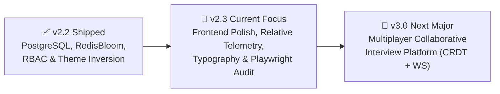

# Technical Architecture Blueprint: Cloud-Judge V2 Roadmap & Execution Plan

**Role:** Systems Architect (`@architect`)  
**Status:** PROPOSED & RATIFIED  
**Target Platform:** AlgoCeleris / Cloud-Judge V2  
**Current Milestone Focus:** **Milestone v2.3 — Frontend Polish, Visual Stability & Automated UI Audit**  
**Future Platform Milestone:** **Milestone v3.0 — Real-Time Multiplayer Collaborative Interview Platform**  
**Operational Invariant:** Read-only planning artifact; zero production code modified during blueprinting.

---

## 1. Executive Roadmap & Milestone Matrix

To ensure rock-solid production stability, visual excellence, and seamless multi-device responsiveness before launching real-time multiplayer features, the roadmap is prioritized as follows:



| Milestone | Scope & Themes | Key Invariants | Target Phases |
|---|---|---|---|
| **v2.3** *(Immediate)* | **Frontend Polish, Visual Stability & Automated UI Audit** | Fix mobile tunnel "offline" badge, enforce relative WS origins, concentric border-radii, tabular-nums, mobile workspace tabs, and headless Playwright verification. | Phases 1–4 |
| **v3.0** *(Next Major)* | **Real-Time Multiplayer Collaborative Interview Platform** | Sub-30ms CRDT code synchronization (`yjs`), multi-cursor awareness, shared sandboxed execution, and private interviewer rubrics. | Phases 5–11 |

---

# PART I: MILESTONE v2.3 ARCHITECTURAL BLUEPRINT
## "Frontend Polish, Visual Stability & Automated UI Audit"

### Design Read & Anti-Slop Dial Calibration (`design-taste-frontend`)
- **Design Read:** High-performance developer platform and online judge for competitive programmers and interview candidates, utilizing the Refero Linear Midnight precision palette, strict hairline geometry, dark mode inversion, and high data density.
- **Dial Calibration:**
  - `DESIGN_VARIANCE: 6` (Structured, intentional, disciplined developer tool; no random artsy chaos).
  - `MOTION_INTENSITY: 4` (Snappy, utilitarian, 150ms transitions; zero lingering floats or bounce slop).
  - `VISUAL_DENSITY: 5` (Compact, high-information cockpit; optimized for multi-pane coding workspaces).

---

## Phase 1: Telemetry & Relative Endpoint Fixes

### 1.1 Problem Audit & Root Cause Analysis
1. **Mobile & Tunnel "Offline" Badge Bug (`LinearHeaderNav.tsx:L19`):**
   - **Defect:** The top navigation latency ping issues a hardcoded request to `http://localhost:8080/health`.
   - **Impact:** When accessing the platform via mobile devices, local area networks (e.g., `192.168.1.x:3000`), or Cloudflare Tunnels (e.g., `https://*.trycloudflare.com`), the client device attempts to ping `localhost:8080` *on the mobile device itself*, which fails and permanently displays the red `"offline"` badge despite the platform being completely healthy.
2. **WebSocket Host Resolution Failure (`api.ts:L198-202`):**
   - **Defect:** `getWsHost()` inspects `window.location.port === '3000'` and conditionally returns `localhost:8080` or fallback `localhost:8000`.
   - **Impact:** On external tunnels, `window.location.port` is empty (`""` for 80/443). Furthermore, hardcoding `localhost:8080` in local development bypasses Vite's built-in `/ws` reverse proxy (`vite.config.ts:L14-19`), which breaks tunnel forwarding and causes mixed-content / CORS rejections on HTTPS tunnels.
3. **API Base URL Fragmentation (`api.ts:L13-18`):**
   - **Defect:** `getApiBaseUrl()` alternates between `http://localhost:8000` and `http://localhost:8080` based on port checks.
   - **Architectural Violation:** Violates `.agents/rules/domain-specific-validation.md` ("Do not hardcode absolute URLs `localhost:8080`; use relative endpoints or dynamic origins").

### 1.2 Architectural Specification
- **Unified Relative Gateway Client:**
  - Replace all hardcoded origin resolvers with a dynamic origin builder:
    ```typescript
    // In production, external tunnels, and Vite dev server, relative URLs route correctly:
    export const getApiBaseUrl = (): string => '';
    ```
  - `LinearHeaderNav.tsx` must ping `/api/v1/health` (relative path) instead of `http://localhost:8080/health`:
    ```typescript
    const res = await fetch('/api/v1/health', { cache: 'no-store' });
    ```
- **Universal Relative WebSocket Builder:**
  - Build WebSocket URLs dynamically from the browser's current location:
    ```typescript
    export const buildWebSocketUrl = (path: string): string => {
      const isHttps = typeof window !== 'undefined' && window.location.protocol === 'https:';
      const wsProtocol = isHttps ? 'wss:' : 'ws:';
      const host = typeof window !== 'undefined' ? window.location.host : 'localhost:3000';
      const cleanPath = path.startsWith('/') ? path : `/${path}`;
      return `${wsProtocol}//${host}${cleanPath}`;
    };
    ```
  - In local development (`localhost:3000`), Vite proxies `/ws` directly to HAProxy (`ws://localhost:8080`).
  - Through Cloudflare Tunnel (`https://xxx.trycloudflare.com`), requests upgrade transparently over `wss://` to the tunnel origin.

### 1.3 Acceptance Criteria & Verification
- `curl -s -I -H "Host: tunnel.trycloudflare.com" http://localhost:3000/api/v1/health` returns `200 OK`.
- Accessing the app through an external hostname or mobile viewport renders the green `"online"` latency badge with true millisecond round-trip telemetry.
- Submission streaming connects over WebSocket without host mismatch errors.

---

## Phase 2: Web Design Guidelines & Typography Audit

### 2.1 Concentric Border-Radii Audit & Mathematical Enforcement
In nested card and container layouts, mismatched border radii create visual friction and "pinched" corners.
- **The Concentric Radius Invariant:**
  $$\text{Radius}_{\text{inner}} = \max\left(0, \text{Radius}_{\text{outer}} - \text{Padding}\right)$$
- **Audit Target Selectors in `index.css`:**
  1. `.linear-nav`: Outer radius `0px` (flush), inner elements `.linear-brand` (`var(--radius-sm)`: 4px), `.latency-pill` (`var(--radius-full)`: 9999px).
  2. `.nav-user-cluster` / `.nav-guest-cluster`:
     - Parent container padding: `3px`. Outer radius: `var(--radius-md)` (6px).
     - Inner avatar / pills: Inner radius must be `6px - 3px = 3px` (or `var(--radius-sm)`).
  3. `.linear-card` & `.auth-card`:
     - Parent outer radius: `var(--radius-lg)` (10px). Parent padding: `24px` / `16px`.
     - Inner input fields (`.linear-input`): Inner radius must be `var(--radius-md)` (6px).
  4. `.problem-table-container`:
     - Table wrapper: `border-radius: var(--radius-lg)` (10px).
     - Inner table header and row hover states must respect corner clipping (`overflow: hidden`).
  5. Modal Dialogs (`.modal-card`, `.ai-debug-modal`):
     - Dialog container: `border-radius: var(--radius-lg)` (10px), padding: `20px`.
     - Internal diff viewer / code block: `border-radius: var(--radius-md)` (6px).

### 2.2 Tabular Figures & Numerical Stability (`font-variant-numeric: tabular-nums`)
Dynamic counter numbers jumping in width as digits change creates visual jitter and layout instability.
- **Enforce `font-variant-numeric: tabular-nums` across:**
  - `.latency-pill`: Latency millisecond counter (`${latency}ms`).
  - `.contest-countdown`: Active/upcoming countdown timers (`HH:MM:SS`).
  - `.problem-row-id`: Problem catalog index numbers (`#1`, `#12`).
  - `.stat-value`, `.metric-value`: User profile statistics and rating cards.
  - `.editor-line-numbers`: Monaco Editor line numbers and test diff viewers.
  - `.stopwatch-timer`: Watchdog countdowns and execution timers.

### 2.3 Optical Alignment, Icon-Text Pairings & Contrast Audit
- **Optical Baseline Alignment:**
  - All icon + label clusters (`.linear-brand`, `.latency-pill`, `.nav-link`, `.tag-pill`, `.btn-primary`) must enforce:
    ```css
    display: inline-flex;
    align-items: center;
    gap: 6px; /* Explicit gap, zero arbitrary margin-right hacks */
    line-height: 1;
    ```
- **Uppercase Tracking Invariant:**
  - Any badge or caption rendered with `text-transform: uppercase` must declare `letter-spacing: 0.04em` to prevent compressed letterforms.
- **Contrast & Token Compliance (WCAG 2.1 AA):**
  - **Dark Mode (Linear Midnight):**
    - Body text: `--text-primary` (`#f7f8f8`) on `--bg-canvas` (`#08090a`) = 18.2:1 (AAA).
    - Secondary text: `--text-secondary` (`#8a8f98`) on `--bg-surface` (`#0f1011`) = 6.4:1 (AA).
    - Hairline dividers: `--border-subtle` (`#23252a`) on `--bg-surface` (`#0f1011`).
  - **Light Mode (Linear Light):**
    - Body text: `--text-primary` (`#111827`) on `--bg-canvas` (`#f7f8f9`) = 16.5:1 (AAA).
    - Muted text: Audit `--text-muted` (`#8b929e`) to ensure minimum 4.5:1 contrast against `#ffffff`.

---

## Phase 3: Anti-Slop Visual Polish & Mobile Layout Hardening [COMPLETED]

### 3.1 Responsive Breakpoints & Viewport Architecture
```css
/* Core Breakpoint System */
--breakpoint-mobile: 768px;
--breakpoint-tablet: 1024px;
--breakpoint-desktop: 1280px;
```

### 3.2 Workspace Mobile Hardening (`ProblemWorkspacePage.tsx` & `ResizableLayout.tsx`)
- **Current Defect:**
  - `ResizableLayout` enforces fixed horizontal split percentages (`leftWidthPercent: 42%`). On mobile viewports (< 768px), this compresses the problem description and code editor into unusable slivers.
- **Architectural Solution:**
  - **Desktop (>= 1024px):** Maintain 3-pane resizable layout with drag handles.
  - **Mobile & Tablet (< 1024px):** Automatically convert the workspace into a high-ergonomics **Tabbed View**:
    - Tabs: `[ 📄 Problem | 💻 Code Editor | 🧪 Test Cases & Output ]`.
    - Active tab takes 100% width and 100% available viewport height.
    - Floating action bar at bottom: Language selector + Acid Lime "Run" and "Submit" buttons always reachable.

### 3.3 Navigation Mobile Hardening (`LinearHeaderNav.tsx`)
- **Mobile Navigation Drawer / Sheet:**
  - On screens < 768px, collapse navigation items (`Problems`, `Contests`, `Latency`, `User Profile`) behind a sleek Obsidian slide-over menu or compact icon bar.
  - Ensure theme toggle and profile links remain accessible without horizontal overflow.

### 3.4 Monaco Editor Touch & Virtual Keyboard Ergonomics
- Add mobile viewport meta and Monaco options for mobile browsers:
  - Disable minimap unconditionally on touch viewports.
  - Increase line number gutter touch target.
  - Bind `automaticLayout: true` with debounced resize observers.
  - Set `overflow: hidden` on parent containers to eliminate iOS Safari bounce-scroll clipping.

### 3.5 Seamless Theme Inversion Transitions
- Add global transition token to eliminate layout flash:
  ```css
  body, .linear-nav, .linear-card, .workspace-pane, .problem-pane {
    transition: background-color 0.15s ease, border-color 0.15s ease, color 0.15s ease;
  }
  ```
- Guarantee that Monaco Editor theme synchronizes via `monaco.editor.setTheme()` without unmounting the component or clearing the undo/redo stack.

---

## Phase 4: Autonomous Playwright & DevTools Verification [COMPLETED]

### 4.1 Verification Strategy
An autonomous, zero-regression verification suite testing the entire platform in headless Chromium across both desktop and mobile viewports.

### 4.2 Route Coverage Matrix
| Route | Viewports Tested | Assertions |
|---|---|---|
| `/` (Landing Page) | Desktop (1440x900), Mobile (390x844) | Hero rendered, benchmark telemetry active, runner teaser functional, 0 console errors. |
| `/problems` (Catalog) | Desktop, Mobile | 12 problems rendered, search input reactive, difficulty tags aligned, no overflow. |
| `/problems/two-sum` (Workspace) | Desktop, Mobile | Desktop: 3 panes visible. Mobile: Tab switcher active, editor rendered, Acid Lime button visible. |
| `/contests` (Contests Hub) | Desktop, Mobile | Countdown timer has `tabular-nums`, registration toggle reactive, leaderboards loaded. |
| `/u/admin` (Profile) | Desktop, Mobile | Rating progress chart, solved ring SVG, 3D skyline canvas visible without clipping. |
| `/auth/login` (Auth Card) | Desktop, Mobile | Centered Carbon card, form inputs valid, concentric radii enforced. |

### 4.3 Automated Verification Harness
- Create script `scripts/verify-ui-audit.mjs` using `@playwright/test` / `playwright`:
  - Starts browser in headless mode.
  - Emulates desktop (`1440x900`) and mobile (`390x844`, iPhone user agent).
  - Listens to `page.on('console', msg => { if (msg.type() === 'error') throw ... })`.
  - Listens to `page.on('pageerror', err => throw err)`.
  - Captures reference screenshots to `.planning/ui-audit-snapshots/`.
  - Asserts zero unhandled exceptions, zero network 404s, and zero layout overflow (`scrollWidth <= clientWidth`).

---

# PART II: MILESTONE v3.0 ARCHITECTURAL BLUEPRINT
## "Real-Time Multiplayer Collaborative Interview Platform"

*(Moved from v2.3 to v3.0 as planned)*

### 1. Architectural Scope & Target Capabilities
- **Sub-30ms bidirectional code synchronization** across distributed clients using Conflict-free Replicated Data Types (CRDT / Yjs).
- **Live multi-cursor & selection presence** rendering colored peer carets and floating name pills in Monaco Editor.
- **Shared sandboxed execution** where either candidate or interviewer triggers run/submit, evaluated inside existing cgroup v2 workers, with live execution events streamed to both terminals simultaneously.
- **Interviewer private evaluation rubric & private notes drawer**.
- **Stateless dual-gateway distribution** over Redis Pub/Sub (`interview:room:{room_id}:events`) behind HAProxy.

### 2. Database Schema (PostgreSQL 16 & Alembic `0002_interview_rooms.py`)
- `interview_rooms`: UUID PK, unique `room_code`, `host_user_id` FK, `candidate_user_id` FK, `problem_slug`, `language`, `status`, `editor_code`, `interviewer_notes`.
- `interview_participants`: UUID PK, `room_id` FK, `user_id` FK, `role` (`host`, `interviewer`, `candidate`), `cursor_color`, `joined_at`.
- `submissions` extension: Add nullable foreign key `room_id` referencing `interview_rooms(id)`.

### 3. Real-Time Protocol (`/ws/interview/{room_code}`)
- Envelope: `{ type, room_code, client_id, user_id, display_name, role, payload, timestamp }`.
- Message taxonomy:
  - `join_room`: Register peer and broadcast presence.
  - `sync`: CRDT binary/delta state replication.
  - `awareness`: Cursor line/column and selection range broadcast.
  - `execution_request`: Triggers sandboxed evaluation.
  - `execution_stream`: Relays worker telemetry (`compiling`, `test_case_start`, `completed`).
  - `control`: Language sync, problem selection, and editor lock.

### 4. Implementation Phasing (Milestone v3.0)
- **Phase 5**: Database Migrations & Interview ORM Entities.
- **Phase 6**: Gateway REST APIs & Room Authorization Guards (`require_pro`).
- **Phase 7**: Redis Pub/Sub Event Mesh & Dual-Gateway WebSocket Relayer.
- **Phase 8**: Shared Sandboxed Execution & Worker Queue Integration.
- **Phase 9**: Frontend Collaborative Monaco Editor & Cursor Presence Engine.
- **Phase 10**: 3-Pane Interview Workspace UI & Private Notes Rubric Drawer.
- **Phase 11**: Multi-Client Automated Stress Testing & Chaos Verification.

---

## Acceptance Criteria for Milestone v2.3 Execution

1. **Phase 1 Verification: [COMPLETED]**
   - Both `http://localhost:3000` and external tunnels report accurate gateway latency (green `"online"` pill).
   - Zero hardcoded `localhost:8080` strings remaining in frontend API and WebSocket clients.
2. **Phase 2 Verification: [COMPLETED]**
   - All nested card/button containers satisfy $R_{\text{inner}} = R_{\text{outer}} - P_{\text{adding}}$.
   - Tabular figures active on all counters; zero jitter during countdowns.
3. **Phase 3 Verification: [COMPLETED]**
   - Problem workspace on viewports < 1024px displays functional tab switcher without clipped Monaco gutters.
   - Light/Dark theme switch triggers zero layout shift or console warning.
4. **Phase 4 Verification: [COMPLETED]**
   - Playwright headless audit crawls all 7 routes on desktop and mobile viewports with **zero console errors** and **zero failed network requests**.

---
*Authored by Systems Architect (`@architect`) — Cloud-Judge V2 Planning Artifact.*
